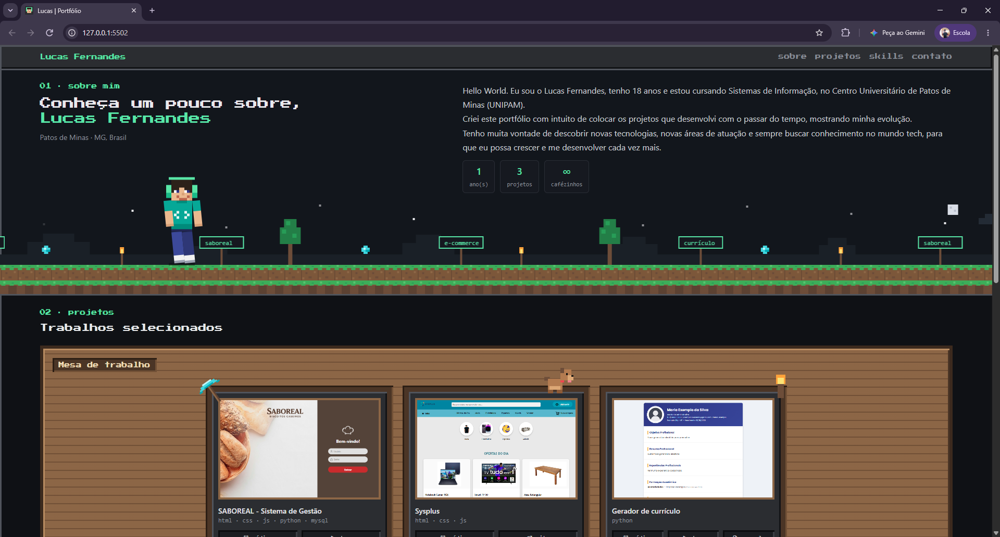

# Meu Portfólio

Meu portfólio com tema pixel/Minecraft: cenário animado, mesa de trabalho com
projetos, inventário de skills e chat de contato.

🔗 **[Ver online](https://seu-link.com)**



## Tecnologias
HTML, CSS e JavaScript puro (módulos ES), sem frameworks.
Ícones do Tabler Icons e fonte Press Start 2P.

## Funcionalidades
- Design responsivo
- Seção de projetos
- Seção de contato

## Como rodar localmente
git clone https://github.com/lucasfbsdev8/portfolio
cd portfolio
Abra a pasta no VS Code, instale a extensão Live Server e clique em "Go Live".
Os módulos JS não funcionam abrindo o `index.html` direto no navegador.

## Estrutura do projeto
```
index.html
css/style.css
js/        main.js, projetos.js, skills.js, contato.js, decoracoes.js
assets/    imagens e favicon
```

## Autor
Lucas Fernandes · Patos de Minas, MG
[E-mail](mailto:fernandesbragalucas529@gmail.com)
[LinkedIn](https://www.linkedin.com/in/lucasfernbs) · [GitHub](https://github.com/lucasfbsdev8)

## Licença
MIT
